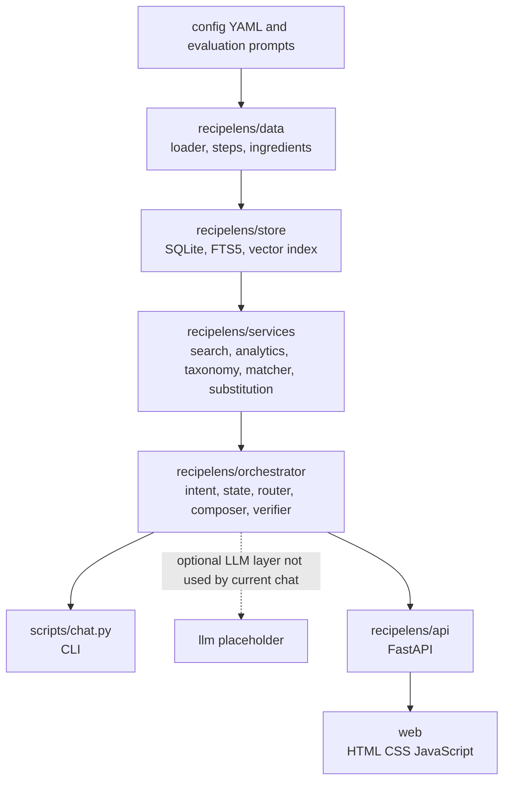

# RecipeLens

RecipeLens is a local conversational recipe search and analysis prototype over Ryan Lee's Recipe
Box dataset. It preserves the source text, applies deterministic ingredient and safety filters,
and shows where its recipe evidence comes from. The current chat uses a rule-based intent parser
and deterministic response templates; it does not call an LLM.

Project artifacts: [data findings](DATA_REPORT.md), [design decisions](DECISIONS.md),
[evaluation results](EVAL.md), and [interview walkthrough](docs/WALKTHROUGH.md).

## Prerequisites and setup

- Python 3.11 (64-bit)
- Git
- `make` is optional; commands below have direct Python equivalents for Windows PowerShell.

```powershell
git clone https://github.com/varshini2304/recipe-ai-agent.git
cd recipe-ai-agent
python -m venv .venv
.\.venv\Scripts\Activate.ps1
python -m pip install --upgrade pip
python -m pip install -e ".[dev]"
```

The install includes pytest, Ruff, NumPy, sentence-transformers, and the ingestion dependencies.
For the optional Gemini one-shot baseline only, install `python -m pip install -e ".[eval]"` and
put `GEMINI_API_KEY=...` in a local `.env` file. `.env` is ignored by Git.

## Get the data and build local files

The [Recipe Box dataset page](https://eightportions.com/datasets/Recipes/) describes the scraped
dataset and links its download. Its downloaded archive includes an
[Open Data Commons Attribution (ODC-By) license](https://opendatacommons.org/licenses/by/1-0/).
That license applies to the database; recipe content from the source websites may have separate
rights. Keep the archive's `LICENSE` with your local data.

Either run `python scripts/download_data.py` and extract the downloaded ZIP into `data_raw/`, or
place the three JSON files directly in `data_raw/`:

- `recipes_raw_nosource_ar.json` - 39,802 records
- `recipes_raw_nosource_epi.json` - 25,323 records
- `recipes_raw_nosource_fn.json` - 60,039 records

The dataset and generated database/index are not included in this repository. Build the SQLite
database and search index:

```powershell
python scripts/inspect_data.py   # optional: inspect source structure first
python scripts/ingest.py
python scripts/build_index.py --limit 5000  # quick development index
# Full index for complete hybrid vector coverage:
python scripts/build_index.py
```

The recorded 5,000-row build took about 159 seconds. The full 122,971-row vector index took
3,622 seconds (about 60 minutes) on the original development machine; your runtime depends on
hardware. `--limit 5000` is useful for development. Task 3 peer search uses FTS5 across the full
database while the vector index is incomplete; the application reports its retrieval mode.

## Run the chat, tests, and evaluation

```powershell
python scripts/chat.py
# Or replay a saved multi-turn transcript:
python scripts/chat.py --script scripts/demo_scripts/conv1_search_dairy.txt
python -m pytest -q             # fast tests, no full-corpus tests
python -m pytest -m "slow or not slow" -q  # complete test suite; requires local data/index
python eval/run_eval.py         # full-database evaluation; writes EVAL.md
```

Equivalent Make targets are `make setup`, `make ingest`, `make test`, `make test-all`, and
`make eval`. The default fast suite currently collects 78 tests: 61 pass and 17 full-corpus tests
are deselected; `make test-all` includes those slow tests. See
[the real-database demo conversations](docs/DEMO_CONVERSATIONS.md) for examples.

## Web UI

With the local database and vector index built, run `python -m recipelens.api` and open
[http://127.0.0.1:8000](http://127.0.0.1:8000). The chat panel supports multi-turn recipe search,
pantry matching, analytics, and substitutions; the results panel shows recipe cards or structured
reports, while the constraint chips can be removed to rerun a query. The API exposes `GET /api/health`,
`GET /api/stats`, `POST /api/chat`, `GET /api/state`, `POST /api/reset`, `POST /api/chip/remove`,
and `GET /api/recipe?id=...`. Counts, filters, ranks, and scores come from the Python services and
SQLite/vector retrieval; the UI only displays their outputs.

## Architecture



Each application layer depends only on lower layers. Service calculations are deterministic;
services do not import an LLM. Conversation parsing and response composition are currently
rule-based.

## Key decisions

- **Retrieval:** SQLite FTS5 BM25 and a normalized MiniLM vector index are combined with reciprocal
  rank fusion when the vector index is complete. Partial/missing vector coverage is reported;
  substitution peers fall back to corpus-wide FTS5.
- **Ingredient normalization and families:** original source title, ingredient list, and
  instructions remain available unchanged. Regex parsing is separate from reviewed synonyms and
  family rules in `config/`; garlic powder, tomato sauce, peanut butter, and coconut milk retain
  their product distinctions. Raw-to-canonical mappings can be audited.
- **Ranking and scoring:** step ranking uses step count by default, with deterministic tie-breaks.
  Pantry weights, quantity conversions, peer evidence thresholds, and evidence grades are
  configured rather than embedded in prompts.
- **Computation vs. language:** Python/SQLite computes counts, percentages, filters, ranking,
  evidence grades, and candidate lists. A future LLM may parse typed intent and phrase supplied
  tool outputs, but it must not calculate dataset statistics. Current chat is a deterministic
  rule engine.
- **Uncertainty and refusals:** unsupported nutrition/time questions are refused because those
  fields are absent. Weak, conflicting, and absent peer evidence are distinguished. No reliable
  adaptation is claimed when support is insufficient.
- **External search:** disabled (`external_search_enabled: false`). General culinary effects in
  adaptation output are labelled as predictions, not dataset evidence; they are not verified.

## Known limitations

- Ingredients without an approved family rule use exact-name matching and can miss variants.
- Text-based allergen matching is not medical advice and cannot establish medical safety.
- Recipe co-occurrence is weak evidence of a substitution, not a tested adaptation.
- The configuration-backed intent parser handles known wording patterns and can miss ambiguous or
  novel phrasing; ambiguous references should be clarified.
- Pantry matching scores a configured candidate cap, so a lower-overlap recipe can be omitted.
- Full vector search requires a locally built index; fresh clones do not contain data or vectors.
- Ingredient quantities, serving-size scaling, and cooking outcomes are not validated.

## AI tools used

- OpenAI Codex (GPT-6) was used in this workspace to implement and review code, tests, evaluation,
  and documentation.
- Claude was used for planning/review as listed in the assignment context.
- The developer reviewed the repository changes and can explain the code. Runtime evaluation of
  chat did not call an LLM; Gemini is only an optional, no-tools baseline in `eval/`.
